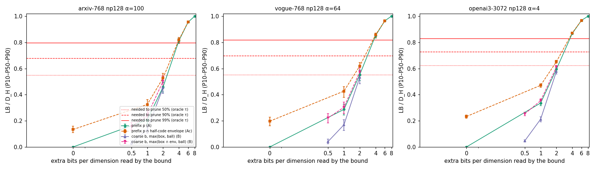
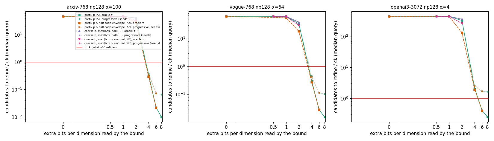
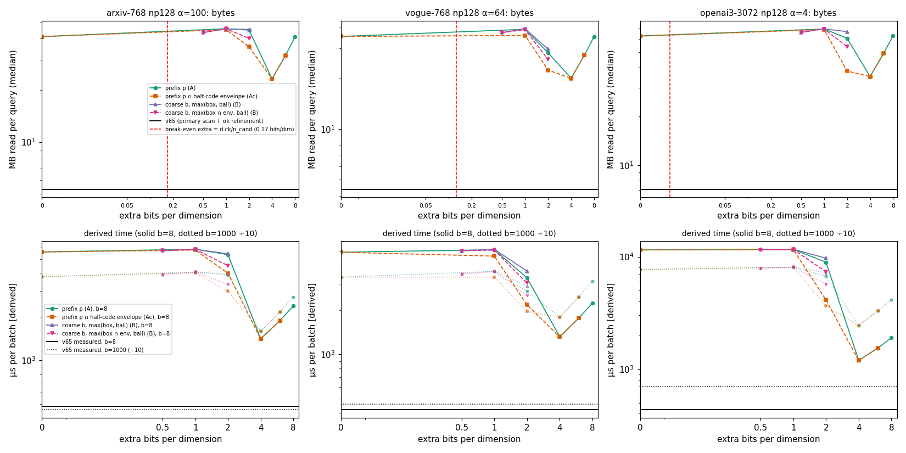

# Bound-Aware Residual Quantization：Pilot 报告

2026-10-13 · RTX 5090（AutoDL）· 分支 `exp/bound-aware-quant-pilot` · 工具 commit `c7e0538` · 索引：arms6 cache（论文那份，未重新训练）· 查询：与上一轮 Pilot 相同的 128 条（种子 20261013）· GPU 占用约 1 分钟（加载索引和 v65 搜索），其余为 CPU 上的 FP64 离线计算

## 结论：NO-GO

- **下界严格正确。** 3 个数据集、23 种下界、每个 probe 候选都做了 FP64 检查：违反 0 次，前缀单调性破坏 0 次；p=8 时下界恰好等于 D_H。
- **只有读到残差码的一半（每维 4 bit）才剪得动。** 这时 arxiv、vogue 的精排数降到 ck 的 0.3–0.5 倍，openai3 仍是 ck 的 2 倍。每维 2 bit 时最多剪掉 36–74%，每维 ≤1 bit 时几乎剪不掉。
- **为 4 维半子空间学习粗码，在同样位数下比逐维前缀更差。**
- **代价远超收益。** 附加信息要在全部 IVF 候选上读取，盈亏平衡点只允许 7–16 字节/向量，而能剪到 ck 以下需要 384–1536 字节/向量，是允许值的 24–226 倍。最好的方案每条查询读 v65 的 4.4–5.0 倍字节，推导时间是 v65 的 2.8–3.9 倍。
- 按 brief，下界没有竞争力，所以**没有实现 GPU microbenchmark**，也没有宣称任何加速。

## 1. 方法与证明

记 a_j = q'_j − ŷ_j(x)，D_H = Σ_j (a_j − r̂_j)²。对任何包含 r̂_j 的区间 I_j，都有 (a_j − r̂_j)² ≥ gap(a_j, I_j)²，求和即得 LB ≤ D_H。

| 方法 | 区间 / 区域 | 为什么一定包含 r̂ | 附加信息 |
|---|---|---|---|
| **A 前缀 p** | 残差码 z 的高 p 位相同的码字是一段连续区间（码本有序），I = [R_m[首], R_m[尾]] | z 本身就在这一段里 | 每维 p bit |
| **Ac 前缀 ∩ 半码包络** | I_p ∩ E_cond[m,s,h,j]（上一轮的半码包络） | 两个区间都包含 r̂，交集也包含 | 同 A |
| **B 粗码 b** | 每个 4 维半子空间做 k-means（2^b 个中心），按标签取全部成员的精确 box 和 ball | box 与 ball 都是在包含 x 在内的全部成员上取的最值；ball 半径向上取整 | 每个半子空间 b bit |

- **单调性：** 前缀区间逐层嵌套（I_8 ⊆ … ⊆ I_1 ⊆ I_0），所以 LB_0 ≤ LB_1 ≤ … ≤ LB_8 = D_H。
- **粗码的组合下界：** box 与 ball 都是合法下界，取最大值仍合法。
- **包络覆盖：** 所有包络都在**全部已索引向量**上构建：arxiv 225 万、vogue 93 万、openai3 100 万；空组为 0。k-means 只用 65,536 个样本训练中心，但标签和包络覆盖全部向量，所以下界是全索引安全的。

## 2. 下界紧度（图 A）

LB/D_H 的中位数（P10–P90 见 `BOUND_TIGHTNESS.csv`）。图中的红线是上一轮测得的“oracle 阈值下剪掉 50% / 90% / 99% 需要的紧度”。

| 方法 | 每维 bit | arxiv | vogue | openai3 |
|---|---:|---:|---:|---:|
| A p=0（码本全范围） | 0 | 0.000 | 0.000 | 0.000 |
| Ac p=0（= 上一轮的 primary-only 下界） | 0 | 0.134 | 0.197 | 0.233 |
| B b=2，max(box∩env, ball) | 0.5 | 0.157 | 0.222 | 0.254 |
| A p=1 | 1 | 0.207 | 0.287 | 0.336 |
| B b=4，max(box∩env, ball) | 1 | 0.241 | 0.304 | 0.354 |
| Ac p=1 | 1 | 0.325 | 0.427 | 0.471 |
| A p=2 | 2 | 0.459 | 0.553 | 0.595 |
| B b=8，max(box∩env, ball) | 2 | 0.503 | 0.574 | 0.611 |
| Ac p=2 | 2 | 0.528 | 0.619 | 0.652 |
| A p=4 | 4 | 0.812 | 0.852 | 0.867 |
| Ac p=4 | 4 | 0.819 | 0.857 | 0.872 |
| A p=6 | 6 | 0.955 | 0.964 | 0.968 |
| A p=8 | 8 | 1.000 | 1.000 | 1.000 |

- **粗码 B 在同样位数下更松：**
  - 2 bit/维：0.50–0.61，而前缀加包络是 0.53–0.65；
  - 1 bit/维：0.24–0.35，而前缀加包络是 0.33–0.47。
- **单独用 box 或 ball 更松：** b=8 时都在 0.41–0.56；不与半码包络取交集的 b=2 只有 0.03–0.05。

## 3. 剪枝与位数（图 B）

| 方法 | 每维 bit | 存活数中位数 / ck（oracle τ） | 渐进精排中位数 / ck（64 个种子） | 渐进精排 ≤ ck 的查询比例 |
|---|---:|---|---|---|
| Ac p=0 / B b=2 / A p=1 / B b=4 | 0–1 | 46–63×（arxiv、vogue），448–454×（openai3） | 同左 | 0–1% |
| A p=2 | 2 | 40.1× / 34.0× / 331× | 40.6× / 34.5× / 334× | 0–2% |
| B b=8 maxcond | 2 | 32.7× / 29.9× / 268× | 32.8× / 30.9× / 268× | 0–2% |
| Ac p=2 | 2 | 28.1× / 18.2× / 133× | 28.2× / 18.7× / 137× | 0–5% |
| A p=4 | 4 | 0.34× / 0.31× / 2.1× | 0.39× / 0.46× / 2.6× | 80% / 83% / 0% |
| Ac p=4 | 4 | 0.29× / 0.28× / 1.9× | 0.34× / 0.42× / 2.5× | 84% / 86% / 0% |
| A p=6 | 6 | 0.02× / 0.03× / 0.40× | 0.07× / 0.11× / 1.7× | 100% / 100% / 0% |

三个数据集按 arxiv / vogue / openai3 的顺序排列。openai3 的 ck 只有 40，只要不能剪到近乎精确，就超过 ck；p≥6 时渐进精排停在 66–67 个，其中 64 个是种子。

## 4. 读取量与估算的 GPU 成本（图 C）

详见 `MEMORY_IO_MODEL.md`。

- **读取量：** v65 每条查询读 4.4–7.1 MB；最好的方案（Ac p=4）读 19.9–35.2 MB，是 4.4–5.0 倍。图中 x=0 处读取量很大，是因为下界剪不掉，要精排全部候选；位数一多，扫描本身又变贵。
- **推导时间 [D]：**
  - b=8：最好的方案 1,191–1,405 µs，v65 实测 422–480 µs，慢 2.8–3.1 倍；
  - b=1000：15.8–24.4 ms，v65 为 4.6–7.0 ms，慢 3.5–3.9 倍。
- **盈亏平衡：** 附加信息 ≤ d·ck/n_cand，即 7–16 字节/向量。所需值是它的 24–226 倍，所以在任何位预算下都追不平 v65。

## 5. 回答

**1. 用现有残差码的高位，能得到有意义的剪枝吗？**
只有读到每维 4 bit（残差码的一半）时才有意义：arxiv、vogue 的精排数降到 ck 的 0.3–0.5 倍，openai3 仍是 ck 的 2 倍。每维 2 bit 时，oracle 阈值下只剪掉 12–48%（加半码包络后 36–74%），存活数仍是 ck 的 18–331 倍。要读的位数太多，不划算。

**2. 几维共享一个粗码，比逐维前缀更有效吗？**
不更有效，在同样位数下反而更松（2 bit/维：0.50–0.61 对 0.53–0.65；1 bit/维：0.24–0.35 对 0.33–0.47）。原因有两点：
- 旋转后各坐标近似独立，4 维 VQ 没有多少联合结构可以利用；
- k-means 的 Voronoi 格子取外接 box 或 ball 时有很多空隙，而有序标量码本的前缀区间是精确的格子。

**3. 最少需要多少额外位，才有希望追平 v65？**
不存在这样的位预算。按读取量算，附加信息必须 ≤ d·ck/n_cand = 7–16 字节/向量（0.02–0.17 bit/维），而且还得一个候选都不用精排；但实测在 0.5–1 bit/维时下界几乎剪不掉任何候选。能把精排降到 ck 以下的是每维 4 bit，即 384–1536 字节/向量，是允许值的 24–226 倍。

**4. 能否在保持原有量化重建值的前提下，取消全局 Top-αk？**
数学上可以。这些下界都严格成立，例如每维 4 bit 前缀，在 arxiv、vogue 上只需精排 ck 的 0.3–0.5 倍，就能认证全 IVF 的精确 top-10。按上一轮的测量，这比 v65 的 recall 高 0–0.24 个百分点。但这要求每个候选多读每维 4 bit，读取量是 v65 的 4–5 倍，推导时间慢 2.8–3.9 倍，所以在成本上不成立。

**5. Bound-Aware Residual Quantization 值得真正训练一个新量化器吗？**
不值得。
- **训练没有带来增益：** 本次最好的结果来自现有 8 bit 有序标量码本的精确前缀，相当于残差逐维的精确分级；学习得到的 4 维粗码在同样位数下反而更松。
- **差距是数量级的：** 要追平 v65，所需位数要降低 20–200 倍。而高维距离集中（上一轮测得候选 D_H 的中位数只有 τ 的 1.6–2.0 倍）决定了剪枝需要 LB/D_H ≥ 0.5–0.8，实测这对应每维 2–4 bit 的信息量。

目前没有证据表明，训练一个新量化器能跨越这个数量级的差距。

## 6. 尚未评估、证据不足的部分

- 按 primary 半码分别训练的粗码本（码本会大 16 倍）。用“box ∩ 半码包络”做了近似，提升有限。
- 总码长不变、从精细残差中挪位给粗码的方案（预算 B 下的粗码）。它会改变重建值，brief 规定先不改。但它与预算 A 的扫描字节相同，IO 结论不变。
- 其他数据集，以及 np=512。

## 7. 复现

| 文件 | 作用 |
|---|---|
| `examples/demo_jhq_v66_bound_aware_quant.cu` | 用 `jhq_v66_boundpilot` 的导出接口；包络、粗码、逐候选 FP64 计算 |
| `run_pilot.sh` | 三个 workload |
| `analyze.py` | `BOUND_TIGHTNESS.csv`、`SURVIVOR_VS_BITS.csv`、`io_model.json`、图 A–C |
| `raw/` | 每个 workload 的逐查询结果、LB/D_H 样本、summary、日志、构建参数 |

v65、ADC 论文和历史实验都未修改。
