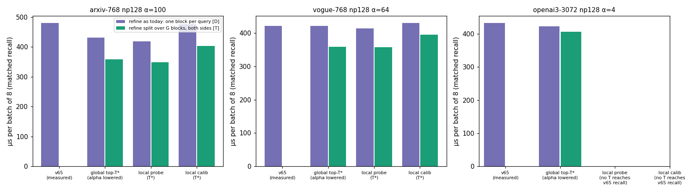

# GPU 成本模型：Local-First 与全局 top-T（batch = 8，G = 8，匹配 recall）

由 `cost_model.py` 生成，结果在 `cost_model.json`，图为 `figures/fig4_cost_model.png`。

**本文件中没有任何一个数字来自新实现的 GPU kernel。** Phase A/B 没有通过前置门槛，按 brief 不进入 GPU 实现。各项的来源标记：

| 标记 | 含义 |
|---|---|
| **[M]** | 实测：pipeline campaign 的 nsys GPU 时间。v63 G8 在原始 α 下的数据，就是 v65 在 b=8 时的执行（`../pipeline_campaign/exp2/v63_raw/perf`）；v62 G8 在降低 α 下的数据，给出扫描和合并时间随每组缓冲区 ck 的变化（`../pipeline_campaign/exp2/raw/nsys`） |
| **[D]** | 推导：实测时间按候选数缩放 |
| **[T]** | 理论：一个写明的假设 |

## 1. 全局 top-ck 现在到底花多少（Q4）

v65 在 b=8 时的实测阶段时间（µs）：

| | 前端 | 扫描 | 全局合并 | 精排 | top-k | host | 总计 |
|---|---:|---:|---:|---:|---:|---:|---:|
| arxiv α100（ck 1000） | 77.5 | 237.4 | **11.9** | 110.6 | 22.7 | 20.1 | 480.1 |
| vogue α64（ck 640） | 67.9 | 226.0 | **8.1** | 72.2 | 21.5 | 26.0 | 421.6 |
| openai3 α4（ck 40） | 177.8 | 177.2 | **3.5** | 24.5 | 16.2 | 33.8 | 433.0 |

- **全局合并 kernel：** 占端到端的 2.5% / 1.9% / 0.8%。b=1000 时 v65 用 G0，没有合并。
- **kernel 边界的等待：** campaign 的 trace 里，扫描→合并→精排→top-k 之间的间隔只有 0.06–0.13 µs。
- **随 ck 增大的选择开销（在扫描内）：** 为保证全局精确，每个组都要保留整整 ck 个候选。这是 Local-First 唯一能动的部分，见第 2 节。
- **理论上界 [T]：**
  - 只去掉合并：≤ 0.8–2.5%；
  - 扫描与精排完全重叠：≤ min(扫描, 精排)/总计 = 23% / 17% / 6%。但 v62 的各组候选数相等、几乎同时结束，实际可重叠的部分远小于此。

## 2. 匹配 recall 时的推导耗时 [D]

模型如下：
- **扫描：** 按 v62 降 α 实测得到的“每组缓冲区 → 扫描时间”曲线插值（对数刻度），并对齐到 v63 的实测值。ck=500 这一点有缓冲区只剩 12 个空槽的已知异常，排除在外。
- **最慢的组决定扫描时间：** 全局方案每组缓冲区为 T；局部方案为最大的 b_g，通常是第 0 组。
- **合并：** 全局方案按 ck 插值；局部方案为 0。
- **精排与 top-k：** 按候选数线性缩放。
- **精排分两种情形：**
  - 现状 [D]：每查询一个 block，耗时 ∝ T；
  - 两边都把精排拆成 G 路并行 [T]：耗时 ∝ 每个 block 分到的候选数。全局方案为 T/G，局部方案为 max b_g。

| workload | 方案 | T | 每组缓冲区（最慢组） | 一块精排：µs（相对 v65） | G 路精排：µs（相对 v65） |
|---|---|---:|---:|---|---|
| arxiv α100 | v65 实测 | 1000 | 1000 | 480.1 | — |
| | 全局 top-T*（α 降为 75） | 750 | 750 | 430.9（×1.11） | 358.4（×1.34） |
| | Local probe-weighted（T*） | 1000 | 367 | 418.0（×1.15） | 348.1（×1.38） |
| | Local calibrated（T*） | 1250 | 598 | 475.8（×1.01） | 403.7（×1.19） |
| vogue α64 | v65 实测 | 640 | 640 | 421.6 | — |
| | 全局 top-T* | 640 | 640 | 421.6（×1.00） | 358.4（×1.18） |
| | Local probe-weighted（T*） | 800 | 294 | 414.1（×1.02） | 357.1（×1.18） |
| | Local calibrated（T*） | 800 | 493 | 430.1（×0.98） | 395.5（×1.07） |
| openai3 α4 | v65 实测 | 40 | 40 | 433.0 | — |
| | 全局 top-T* | 30 | 30 | 422.7（×1.02） | 406.6（×1.06） |
| | Local（probe / calib） | — | — | G=8 时 T ≤ 1.5·ck 也达不到 v65 的 recall | — |

## 3. 解读

- **局部对全局的推导优势最多 2–3%。**
  - 来源：按 probe 加权时，第 0 组的缓冲区更小（367 对 750），扫描少一些选择开销，又省掉合并；
  - 代价：多精排 25–33% 的候选；
  - 结果：在 arxiv、vogue 上 b=8 时约快 2–3%。
  - 这远低于 brief 要求的 ≥10%，也在模型误差范围内：曲线来自另一次运行；缓冲区 367 时只剩 145 个空槽，可能比插值更慢。
  - 校准分配给第 0 组 48–65% 的预算，最慢组的缓冲区与全局方案相差无几，所以比全局方案更慢。
- **b=1000 时局部方案吃亏。** v65 用 G0（每查询一个 block，没有合并）。Local-First 必须分组，而 v62/v63 实测显示，大 batch 下分组本身就有退化。
- **两个更大的推导收益都属于全局方案，与“局部选择”无关：**
  - α 降 25%：arxiv 的 recall 不变（测试集配对差 −0.0002，置信区间 [−0.0007, 0]），推导快约 10%；
  - 精排拆成多 block 并行：现在的精排 kernel 每查询只有一个 block，b=8 时只用 8 个 SM，理论上两种方案都能快约 20–30%。

  这两项都没有在 GPU 上实测，只能作为后续方向的依据，不能当作加速结果。
