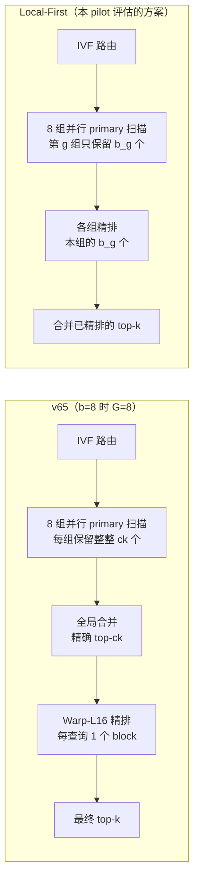
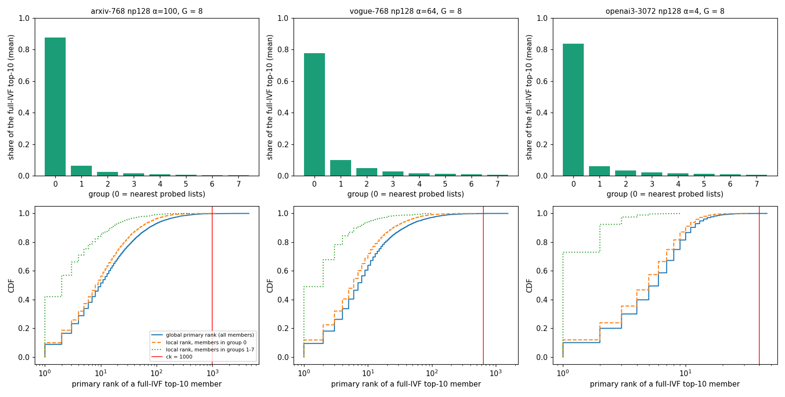
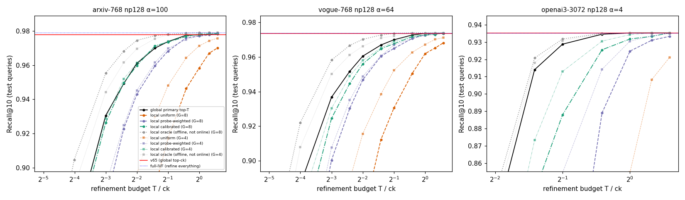
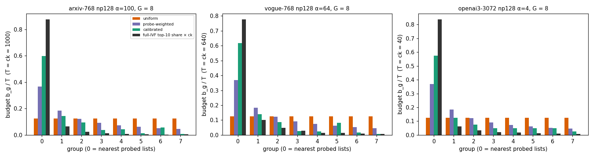

# Local-First Refinement：研究 Pilot 报告

2026-10-13 · RTX 5090（AutoDL）· 分支 `exp/local-first-refinement-pilot`（独立 worktree）· 工具 commit `9c56b9e` · 索引：arms6 cache（论文那份，未重新训练）· 查询：三个数据集各**全部 1000 条**，按种子 20261013 划分为校准 400 / 验证 200 / 测试 400 · GPU 占用约 1 分钟（只有导出时跑的 v65 搜索）

## 结论：NO-GO（Phase B 门槛未通过，未做 GPU 实现）

- **相同精排预算下，可在线实现的局部选择从不优于全局 top-T。** G=8 时，均匀分配、按 probe 加权、在校准集上学习的分配，在每个预算下都与全局持平（置信区间包含 0）或显著更差。arxiv 均匀分配差 2–23 个百分点，openai3 差 33–51 个百分点。只有离线 oracle 分配更好（0 到 +2.5pp），但它要事先知道近邻在哪个组，在线不可能做到。
- **匹配 v65 的 recall，局部方案需要更多预算。** 全局 top-T 只需 0.75×ck（arxiv、openai3）或 1.0×ck（vogue）；最好的在线局部策略要多 25–33%（较差的校准策略要多 67%）。openai3 在 G=8 时，T ≤ 1.5×ck 也达不到。
- **第 0 组负载过重。** 全 IVF top-10 有 78–88% 落在第 0 组；校准分配也把 48–65% 的预算给了第 0 组。
- **执行上的空间太小。** 全局合并只占 b=8 端到端的 0.8–2.5%。推导得到局部方案最多比降 α 后的全局方案快 2–3%，在模型误差范围内，远低于 10% 的门槛。b=1000 时局部方案还会退化。

## 1. 执行流程

## 2. 源码审计

| 问题 | 结论（依据） |
|---|---|
| v62 如何分组 | 把探测到的 list 按 probe 顺序首尾相接，再在 floor(n·g/G) 处切开，各组候选数相差不超过 1；一个 list 可能被分到两组（`scan_ivf_group_kernel`）。本 pilot 严格复现了这一切分 |
| 局部 top-k 的排序规则 | `key_less = (primary distance, position)` 严格全序；threshold-compaction 缓冲区加 bitonic 排序 |
| v63 共享界能否复用 | **不能，必须禁用。** 共享界的依据是“某组的第 ck 个 key 是全局第 ck 个 key 的上界”，只对全局 top-ck 成立。用在局部选择上，会把各组本该保留的局部候选剪掉，局部选择就退化成了全局选择 |
| Warp-L16 精排的映射 | `residual_refine_group_kernel<BR,16><<<B, RB>>>`：**每查询一个 block**，16 个 lane 处理一个候选，block 内循环处理 ck 个候选。所以 b=8 时只用 8 个 SM |
| 局部精排能否放在同一个 CTA | 能，但第 0 组的 CTA 要承担 37–65% 的精排，每轮只能并行 512/16 = 32 个候选，第 0 组就成了关键路径。放进单独的 kernel 则仍有一个 kernel 边界 |
| 省掉什么、增加什么 | 省掉：全局合并 kernel，以及“每组都要保留整整 T 个”的选择开销。增加：匹配 recall 所需的额外精排候选；而在同一 CTA 内精排时，会损失精排并行度 |

## 3. Phase A：全 IVF top-10 在各组中的 primary 排名（离线，全部 1000 条查询）

| 数据集（G=8） | 第 0 组占全 IVF top-10 的比例 | 最大全局 primary 排名：P50 / P95 / P99 / max | oracle 局部总预算 Σ_g max 局部排名：P50 / P95 / P99 / max | ck |
|---|---:|---|---|---:|
| arxiv α100 | 88% | 77 / 543 / 1324 / 4503 | 56 / 261 / 520 / 1120 | 1000 |
| vogue α64 | 78% | 37 / 237 / 525 / 1542 | 26 / 116 / 219 / 484 | 640 |
| openai3 α4 | 84% | 13 / 23 / 31 / 46 | 12 / 19 / 24 / 34 | 40 |

- 第 0 组的比例随 G 变化：G=2 时 95–98%，G=16 时 65–79%。
- **第 0 组成员的组内排名几乎等于全局排名**（图 1 下排：橙色虚线与蓝线基本重合），因为 primary 排名靠前的竞争者本来就大多在第 0 组。
- 其他组的成员组内排名很低，但数量很少。
- 所以“局部”带来的排名优势，只有在事先知道每组该分多少预算时才能兑现，这正是 oracle 能做而在线策略做不到的。

## 4. Phase B：相同预算 T 下，全局与局部的比较

测试集（400 条查询）上的配对比较，G=8；差值 = 局部 − 全局的 Recall@10，括号内为 bootstrap 95% 置信区间：

| 数据集 | T / ck | 全局 | 均匀 | 按 probe 加权 | 校准 | oracle（离线） |
|---|---:|---:|---|---|---|---|
| arxiv | 1/8 | 0.9305 | −0.226 [−0.241, −0.211] | −0.051 [−0.059, −0.043] | −0.004 [−0.010, +0.002] | +0.025 |
| arxiv | 1/2 | 0.9738 | −0.057 [−0.065, −0.048] | −0.006 [−0.008, −0.003] | −0.000 [−0.003, +0.002] | +0.004 |
| arxiv | 1 | 0.9778 | −0.020 [−0.025, −0.015] | −0.001 [−0.002, +0.000] | +0.001 [+0.000, +0.001] | +0.001 |
| vogue | 1/8 | 0.9368 | −0.199 [−0.215, −0.183] | −0.037 [−0.044, −0.030] | −0.012 [−0.017, −0.008] | +0.022 |
| vogue | 1/2 | 0.9700 | −0.040 [−0.048, −0.032] | −0.005 [−0.008, −0.002] | −0.002 [−0.005, −0.000] | +0.004 |
| vogue | 1 | 0.9738 | −0.012 [−0.017, −0.008] | −0.001 [−0.002, +0.000] | −0.001 [−0.002, +0.000] | +0.000 |
| openai3 | 1/2 | 0.9287 | −0.498 [−0.517, −0.479] | −0.190 [−0.202, −0.177] | −0.041 [−0.048, −0.035] | +0.003 |
| openai3 | 1 | 0.9353 | −0.326 [−0.342, −0.309] | −0.011 [−0.014, −0.008] | −0.004 [−0.006, −0.002] | +0.000 |

**匹配 recall：** 在验证集上选出达到 v65 recall 的最小 T，在测试集上报告（G=8）。

| 数据集 | v65（ck） | 全局 top-T* | 按 probe 加权 T* | 校准 T* | 均匀 T* | oracle（离线）T* |
|---|---:|---:|---:|---:|---:|---:|
| arxiv | 1000 | **750**（测试 0.9775，v65 0.9778） | 1000 | 1250 | > 1500 | 375 |
| vogue | 640 | **640**（0.9738 / 0.9738） | 800 | 800 | > 960 | 320 |
| openai3 | 40 | **30**（0.9345 / 0.9353） | > 60 | > 60 | > 60 | 30 |

其他 G 的结果：
- **G=2 时，校准分配追平全局：** arxiv T=750，openai3 T=30。因为两组时第 0 组就占 95–98%，基本等于全局选择。
- **G 越大，局部方案需要的预算越多。**

完整数据见 `GLOBAL_VS_LOCAL.csv` 和 `RECALL_VS_BUDGET.csv`。

**图 3（T = ck）：**
- 均匀分配把 7/8 的预算给了几乎没有近邻的组；
- 按 probe 加权和校准分配都把最多的预算给第 0 组，校准分配给了 48–65%；
- 第 0 组因此成为最慢的组。

## 5. GPU 成本（推导，未实测）

详见 `GPU_COST_MODEL.md`。

- **全局合并：** 3.5–11.9 µs，占 b=8 的 0.8–2.5%；b=1000 时为 0。
- **匹配 recall 时的推导耗时：** 按 probe 加权的局部方案比降 α 后的全局 top-T* 快约 2–3%（arxiv 418 对 431 µs，vogue 414 对 422 µs）。这在模型误差范围内，远低于 10% 的门槛。校准分配更慢。
- **两个更大的推导收益都属于全局方案：**
  - α 降 25%：arxiv 约 ×1.11；
  - 精排拆成多 block 并行：约 ×1.2–1.3，这是理论值。

  它们都不需要局部选择。

## 6. 回答

**Q1：全 IVF 最终 top-10 的组内 primary 排名够低吗？**
不够。〔离线〕第 0 组包含 78–88% 的成员，而它们的组内排名几乎等于全局排名（arxiv P95：245 对 543）。只有其他组的少数成员组内排名很低。要利用这一点，必须事先知道每组该分多少预算，这只有 oracle 能做到。

**Q2：在相同精排预算 T 下，Local-First 是否比全局 top-T 更容易保留最终近邻？**
否。
- 〔证明〕如果“候选是近邻的概率”只随 primary 距离单调下降，那么在所有 T 元子集中，全局 top-T 的期望覆盖数最大。这可以用交换论证得到：把集合外一个 primary 距离更小的候选换进来，期望覆盖数不会减少。局部选择只是另一种 T 元子集。
- 〔离线〕实测与此一致：所有在线策略在每个 T 下都不优于全局（置信区间包含 0，或显著更差）。

**Q3：Local-First 能否用更少的精排候选保持 v65 的 recall？**
不能。〔离线〕在线局部策略需要 T* = 1.0–1.25×ck（arxiv、vogue），openai3 在 G=8 时 T ≤ 1.5×ck 也达不到。全局 top-T 只需 0.75–1.0×ck。

**Q4：全局 top-ck 目前带来多少无法隐藏的 GPU 执行成本？**
〔GPU 实测，来自 campaign 的 nsys 数据〕
- b=8 时，全局合并 3.5–11.9 µs（0.8–2.5%）；kernel 边界只有 0.06–0.13 µs。
- 此外是“每组保留整整 ck 个”的选择开销，在扫描内部；但第 0 组无论如何都要承担大部分预算，局部方案能省下的很有限。
- b=1000 时 v65 用 G0，没有合并。

**Q5：Local-First 能真正消除全局选择屏障，而不是把它转移成另一个昂贵的同步吗？**
不能真正消除。〔分析〕
- 用单独的精排 kernel：扫描到精排的 kernel 边界还在，只是少了合并 kernel；最终仍要对每条查询已精排的 T 个候选做一次 top-k，这一步 v65 本来就有。
- 把精排融合进扫描 CTA：第 0 组承担 37–65% 的精排，每轮只能并行 32 个候选，成为新的关键路径。

**Q6：在相同 recall 下，Local-First 有证据超过重新优化 α 后的 v65 吗？**
没有。〔推导，未实测〕最多快 2–3%，在模型误差内；b=1000 时更慢。门槛是在独立测试集、真实 E2E 上稳定快约 10%，远未达到。

## 7. 决定

**NO-GO。**
- 局部选择在相同 T 下持续弱于全局 top-T；
- 维持 recall 所需的局部预算 ≥ 全局所需，并接近或超过原始 ck；
- 第 0 组负载过重；
- 可节省的全局同步成本（合并）只有 0.8–2.5%。

按 brief，停止，不做 GPU 实现，也不转向其他未批准的方案。

**附带发现（只是推导，供参考；不属于 Local-First）：**
1. **v65 的 α 偏保守：** 全局 top-T 在 0.75×ck 时，arxiv、openai3 的测试集 recall 与 v65 相同（配对置信区间包含 0），推导可快约 10%。这涉及论文的 sampled-rule α，需要单独评估。
2. **精排 kernel 每查询只有一个 block：** b=8 时只用 8 个 SM，与 v61 原来的扫描一样缺并行度。把精排按（查询，候选块）拆分，理论上能在 b=8 时快 20–30%，而且结果不变。

## 8. 区分说明

| 类型 | 内容 |
|---|---|
| 已证明的数学性质 | 局部排名 ≤ 全局排名；在单调似然假设下，全局 top-T 的期望覆盖数最大（交换论证）；共享界只对全局 top-ck 成立 |
| 离线模拟结果 | 第 3、4 节全部数字（FP64，与 v65 实际 recall 一致：测试集模拟 0.9778 / 0.9738 / 0.9353，实际 0.9778 / 0.9738 / 0.9350） |
| GPU 实测结果 | 第 5 节中“v65 实测”的阶段时间（来自 pipeline campaign 的 nsys）；本 pilot 没有新的 GPU 计时 |
| 尚未验证的假设 | 第 5 节的全部推导耗时；附带发现 1 和 2 |

## 9. 复现

| 文件 | 作用 |
|---|---|
| `run_pilot.sh` | 用 `demo_jhq_v66_bound_pilot` 导出全部 1000 条查询，再运行 `analyze.py` |
| `analyze.py` | Phase A/B；生成 `GROUP_RANK_ANALYSIS.csv`、`GROUP_RANK_MEMBERS.csv.gz`、`RECALL_VS_BUDGET.csv`、`GLOBAL_VS_LOCAL.csv`、`summary.json` |
| `figures.py` | 图 1–3 |
| `cost_model.py` | `GPU_COST_MODEL.md` 的数字和图 4 |
| `raw/` | 导出日志、构建日志、运行日志 |

逐候选的导出数据（约 5 GB）留在服务器 `/root/autodl-tmp/lf_pilot`。v65、论文、历史实验和训练缓存都未修改。
