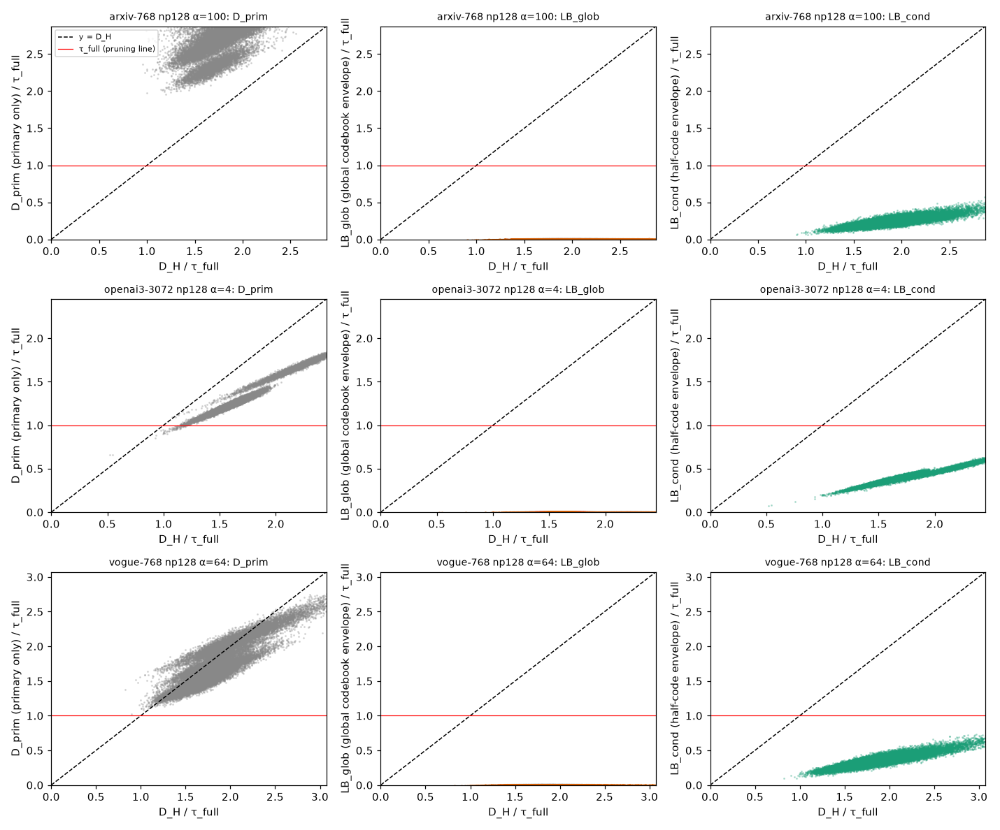
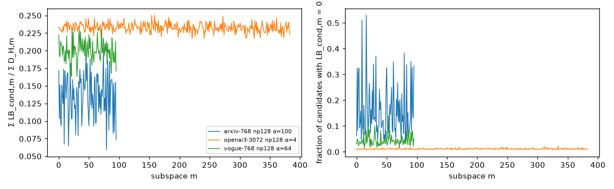
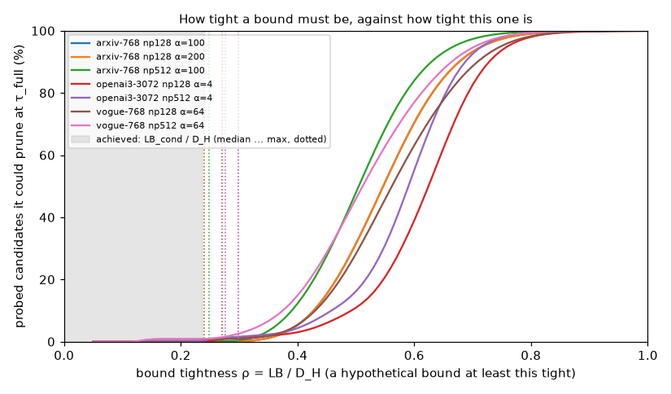
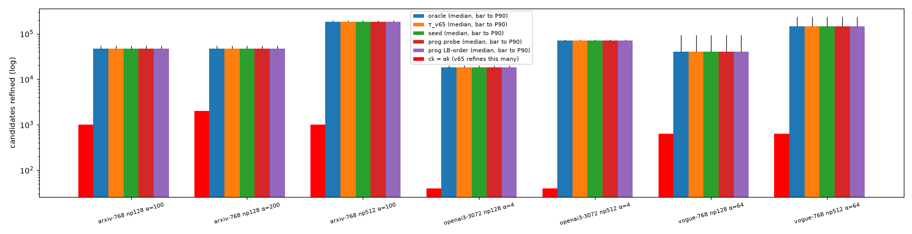
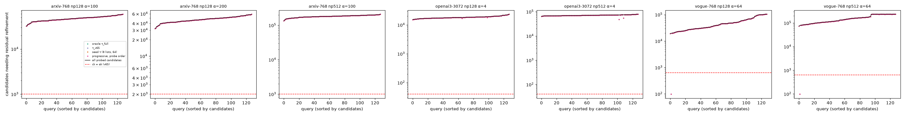
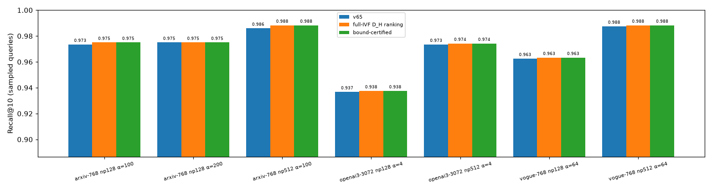
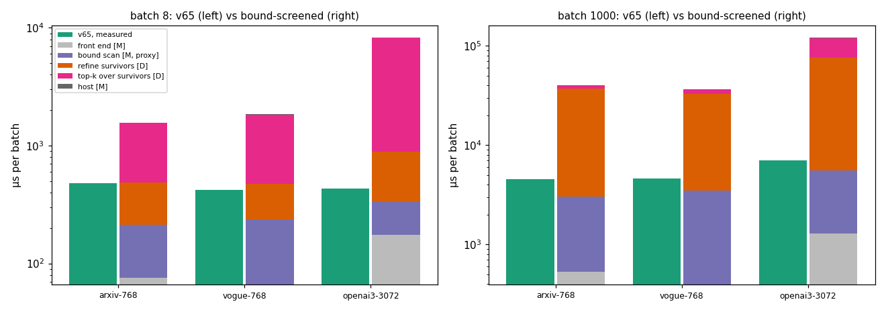

# Residual-Aware Factorized Screening：数学可行性 Pilot 报告

2026-10-13 · RTX 5090（AutoDL）· 分支 `exp/residual-aware-bound-pilot` · 工具 commit `644d50d`、`19b4786` · 索引：arms6 cache（论文那份，未重新训练）· 查询：每个 workload 128 条，随机种子 20261013（前 16 条先做技术验证）· GPU 实际占用约 3 分钟

## 结论：NO-GO

- **数学上成立。** 只用 primary 码，确实能给最终残差重建距离 D_H 构造一个精确、安全的下界，而且仍是每子空间 16+16 项的查表形式。在 7 个 workload、896 条查询、7,280 万次候选检查中，违反次数为 0。
- **但下界太松，无法使用。** 它只抓住了 D_H 的 13–24%（中位数），最多 30%。而 probe 列表里的候选距离高度集中：D_H 中位数只有 τ 的 1.6–2.0 倍。要剪掉哪怕 10% 的候选，下界至少要达到 D_H 的 37–49%。结果是即使用理想的 oracle 阈值，**存活候选也约等于全部 probe 候选，是原始 αk 的 24–1774 倍**（896 个查询实例中只有 2 个例外，都是同一条 vogue 查询，见第 5 节）。
- **去掉 top-αk 也换不来质量。** 全 IVF 精确重建排序的 Recall@10 只比 v65 高 0–0.24 个百分点。v65 的 primary top-αk 已经包含全 IVF 前 10 名中的 99.8–100%。
- 按实测数据推导，这条 pipeline 在 b=8 时最多只有 v65 速度的 0.45–0.93 倍，b=1000 时为 0.06–0.14 倍。没有开发 v66 完整系统，也没有提前宣称任何加速。

## 1. 源码审计：JHQ 的实际数学表示

| 组成 | 源码位置 | 实际形式 | 数值验证（全部 N 个向量） |
|---|---|---|---|
| Primary 码 | `encode.cu` `encode_fused_cartesian_kernel` | 每维 1 个 digit，L = 2 个**全局** level（768 维 ±0.02434，3072 维 ±0.01217），8 维一个子空间凑成 1 字节，第一维是最高位 | level 不匹配：0 / 196,608（768 维）、0 / 786,432（3072 维） |
| 16+16 半码 | `search.cu` `build_byte_lut_kernel` | 高 4 bit 决定子空间前 Ds/2 = 4 个坐标，低 4 bit 决定后 4 个坐标 | 可分解性不匹配：0 |
| 残差 | `encode.cu` | r = x'_j − ŷ_j，用子空间 m 的**有序**标量码本（Kr = 256，8 bit/维）就近量化；r̂_j = R_m[code_j] | 码本无序对：0 |
| corr | `encode.cu` | corr = Σ 2·ŷ_j·r̂_j = 2⟨ŷ, r̂⟩ | 最大绝对误差 1.3–2.8e-7（float 舍入） |
| composite | `search.cu` `residual_refine_*` | comp = ‖q'−ŷ‖² + ‖q'−r̂‖² + corr | **comp = D_H + ‖q'‖²**：FP64 相对误差 1.2–2.3e-7；v65 GPU 返回值相对误差 ≤ 3.1e-5 |
| 物理布局 | `jhq_gpu_index.cu` | primary 码为 `[M/4][N]` uint32 word；残差为 `[N][d]` 字节；corr 为 `[N]`；按 list 顺序存放 | 导出后逐向量解码 |

因此按 composite 排序，等价于按 D_H = ‖q'−ŷ−r̂‖² 排序，两者只差一个与候选无关的常数 ‖q'‖²。这与 brief 的预期一致，也已用代码和数值确认。

## 2. 下界的构造与证明

对子空间 m 的半码 s ∈ {高, 低}、取值 h（16 种）和该半码覆盖的每个坐标 j，在**全部已索引向量**上流式统计：

> E[m,s,h,j] = [ min r̂_j , max r̂_j ]，最小、最大取遍所有该半码等于 h 的已索引向量

全局对照：E_glob[m] = [min_k R_m[k], max_k R_m[k]]，即整个残差码本的范围。

**证明。**
1. 对任一已索引向量 x，r̂_j(x) ∈ E[m,s,h(x),j]，因为 x 自己就在取最值的那组向量里。
2. 令 a_j = q'_j − ŷ_j(h)，gap(a, [l,u]) = max(0, l−a, a−u)。对任意 r ∈ [l,u] 有 (a − r)² ≥ gap(a,[l,u])²。
3. 逐坐标求和得到：

   > D_H(q,x) = Σ_j (a_j − r̂_j)² ≥ Σ_m [ T_hi[m](h_m) + T_lo[m](l_m) ] = LB_cond(q,x)

   其中 T[m](h) = Σ_{j∈半码} gap(a_j, E[m,s,h,j])²。这是只依赖查询的每子空间 16+16 项表，扫描时只读 primary 码。
4. E_glob ⊇ E，所以 LB_glob ≤ LB_cond ≤ D_H。

**证明成立的前提：** 包络覆盖全部已索引向量；抽样构建的包络不保证成立。新增向量时可以在 O(d) 内单调地放宽包络，删除向量则需要重建受影响的状态。本 pilot 全部用 FP64 计算；若要做 FP32 的 GPU 实现，必须另外处理舍入误差，例如把包络向外取整。

**包络代价（实测）：**
- CPU 上流式构建 0.19–0.94 s；额外存储 96 KB（768 维）或 384 KB（3072 维）。
- arxiv 有 54 / 3072 个半码状态没有任何向量使用。它们被标记为 NaN，全部候选中 NaN 下界为 0。
- 平均包络宽度：条件包络 0.080 / 0.127 / 0.071，全局包络 0.177 / 0.227 / 0.122（arxiv / vogue / openai3）。

## 3. Pilot A：下界正确性

**结果：** 7 个 workload、896 条查询、7,280 万次候选检查，LB_cond 与 LB_glob 违反次数均为 **0**。max(LB − D_H) 始终为负：vogue 最接近，为 −2.8e-5；openai3 为 −0.17。

**图 1 怎么读：** 横轴是 D_H/τ，纵轴是各指标/τ；红线是剪枝线，只有落在红线以上的点才能被剪掉。
- **左列 D_prim 不是下界：** 它在 arxiv 上整体大于 D_H，在 openai3 上整体小于 D_H。
- **中列 LB_glob ≈ 0：** 残差码本的范围覆盖了整个 primary 格子。
- **右列 LB_cond：** 全部在 y = D_H 以下（正确），但也全部在红线以下（剪不掉）。

| workload | LB_cond/D_H 的 P10 / P50 / P90 / P99 / max | LB_glob/D_H 中位数 | D_prim/D_H 的 P10–P90 |
|---|---|---:|---|
| arxiv np128 | 0.108 / **0.133** / 0.159 / 0.180 / 0.240 | 0.000 | 1.26–1.72（100% > 1） |
| vogue np128 | 0.162 / **0.195** / 0.226 / 0.248 / 0.298 | 0.000 | 0.82–1.11（28% > 1） |
| openai3 np128 | 0.220 / **0.233** / 0.244 / 0.252 / 0.271 | 0.000 | 0.75–0.81（0% > 1） |

**图 5：**
- **各子空间的下界贡献都低：** openai3 稳定在约 0.23，vogue 为 0.17–0.22，arxiv 为 0.06–0.18。
- **arxiv 下界为 0 的比例很高：** 部分子空间里多达一半候选的下界为 0，即查询在该子空间的每个坐标都落在候选格子的包络内。

## 4. 下界需要多紧，实际有多紧

假设某个下界的紧度为 LB = ρ·D_H。它能剪掉候选 x，当且仅当 ρ·D_H(x) > τ_full。这个量只取决于 D_H 本身的分布，所以对**任何**这种紧度的下界都成立。

| workload | 剪掉 10% 需要 ρ ≥ | 50% | 90% | 99% | 实测 ρ：中位数 / 最大 | D_H/τ：中位数 / P99 / max |
|---|---:|---:|---:|---:|---|---|
| arxiv np128 | 0.43 | 0.55 | 0.68 | 0.80 | 0.13 / 0.24 | 1.82 / 2.88 / 5.40 |
| vogue np128 | 0.42 | 0.55 | 0.70 | 0.82 | 0.20 / 0.30 | 1.81 / 3.00 / 9.80 |
| openai3 np128 | 0.49 | 0.62 | 0.73 | 0.83 | 0.23 / 0.27 | 1.60 / 3.57 / 4.69 |
| arxiv np512 | 0.39 | 0.51 | 0.63 | 0.75 | 0.14 / 0.25 | 1.98 / 3.14 / 5.77 |
| vogue np512 | 0.37 | 0.51 | 0.66 | 0.78 | 0.21 / 0.30 | 1.98 / 3.79 / 10.01 |
| openai3 np512 | 0.46 | 0.59 | 0.69 | 0.78 | 0.24 / 0.28 | 1.70 / 3.89 / 4.84 |

**为什么这么松：**
- primary 码每维只有 1 bit，每个坐标的格子是一条半直线，残差可以落在半直线上任意位置。
- 所以下界几乎只在“查询与候选在该坐标上符号相反”时才计入，大小约为查询到边界的距离平方。
- probe 到的候选本来就和查询相近，符号相反的坐标少，而且多是查询本身就靠近边界的坐标。

## 5. Pilot B / C：需要精排多少候选

| workload | IVF 候选数：中位数 / P90 / max | 原始 ck | oracle τ 下的存活数：中位数 / P90 / P95 / P99 / max | 存活数 / ck | 低于 ck 的查询比例 |
|---|---|---:|---|---:|---:|
| arxiv np128 α100 | 47,205 / 55,109 / 59,072 | 1,000 | 47,205 / 55,109 / 57,163 / 57,928 / 59,072 | 47× | 0% |
| arxiv np128 α200 | 同上 | 2,000 | 同上 | 24× | 0% |
| arxiv np512 α100 | 182,998 / 199,080 / 210,082 | 1,000 | 182,998 / 199,080 / 201,043 / 206,333 / 210,082 | 183× | 0% |
| vogue np128 α64 | 40,568 / 95,159 / 104,055 | 640 | 40,568 / 95,159 / 99,866 / 103,649 / 104,055 | 63× | 1% |
| vogue np512 α64 | 147,576 / 235,294 / 235,912 | 640 | 146,832 / 235,010 / 235,438 / 235,827 / 235,912 | 229× | 1% |
| openai3 np128 α4 | 18,142 / 20,462 / 23,570 | 40 | 18,100 / 20,462 / 21,694 / 22,836 / 23,570 | 453× | 0% |
| openai3 np512 α4 | 71,160 / 75,648 / 79,155 | 40 | 70,940 / 75,648 / 76,947 / 78,384 / 79,155 | 1774× | 0% |

- **全部阈值都失败：** 无论用 oracle τ_full、τ_v65，还是任何 seed 阈值（最近 1/2/4/8 个 list × 32/64/128 个种子），存活数都约等于全部候选。
- **渐进精排同样失败：** 按 probe 顺序、存储位置顺序或 LB 顺序（离线理想），实际精排数也都约等于全部候选。
- **原因：** 连 oracle 阈值都剪不掉候选，任何实际可行的阈值都只会更差。
- **唯一的例外：** vogue 的查询 917（在 np128 和 np512 两个 workload 中各出现一次，即 896 个查询实例中的 2 个）。它的 τ_full = 0.206，是全部 vogue 查询中最小的（中位数 0.576），也就是前 10 名比其余候选近得多。在这条查询上，条件下界把 19,727 个候选剪到只剩 98 个，少于 ck 的 640；全局下界仍然一个也剪不掉。可见下界只对“近邻与其余候选距离差距很大”的极少数简单查询有效。
- 每条查询的完整数据见 `SURVIVOR_ANALYSIS.csv`，全部方法的长表见 `SURVIVOR_ANALYSIS_long.csv.gz`。

## 6. Pilot D：检索质量

| workload | v65 | 全 IVF D_H 排序 | 下界认证结果 | 认证结果 = 全 IVF | v65 与全 IVF 的交集 | 全 IVF 前 10 名落在 v65 top-αk 内的比例 |
|---|---:|---:|---:|---:|---:|---:|
| arxiv np128 α100 | 0.9734 | 0.9750 | 0.9750 | 100% | 99.84% | 99.84% |
| arxiv np128 α200 | 0.9750 | 0.9750 | 0.9750 | 100% | 100% | 100% |
| arxiv np512 α100 | 0.9859 | 0.9883 | 0.9883 | 100% | 99.77% | 99.77% |
| vogue np128 α64 | 0.9625 | 0.9633 | 0.9633 | 100% | 99.92% | 99.92% |
| vogue np512 α64 | 0.9875 | 0.9883 | 0.9883 | 100% | 99.92% | 99.92% |
| openai3 np128 α4 | 0.9367 | 0.9375 | 0.9375 | 100% | 99.92% | 100% |
| openai3 np512 α4 | 0.9734 | 0.9742 | 0.9742 | 100% | 99.84% | 100% |

- 在 probe 到的全部候选上按精确重建距离排序，Recall@10 比 v65 **最多高 0.24 个百分点**（arxiv np512），在本样本上从未降低。
- 下界认证的结果与全 IVF 排序 100% 一致，这是精确剪枝应有的性质。
- 上面的 recall 是 128 条抽样查询上的值，不能直接和全量查询的 recall 对比。

## 7. Pilot E：性能

存活数不具竞争力，按 brief 的规定**未做新 kernel 的 microbenchmark（SKIPPED）**。成本模型（`COST_MODEL.md`）只用 campaign 的实测 kernel 时间，乘以本次实测的存活数推导，每一项都标明来源。

| | arxiv α100 | vogue α64 | openai3 α4 |
|---|---|---|---|
| b=8，相对 v65（乐观 … 按实测速率） | ×0.93 … ×0.30 | ×0.83 … ×0.22 | ×0.45 … ×0.05 |
| b=1000，相对 v65 | ×0.12 … ×0.11 | ×0.14 … ×0.13 | ×0.09 … ×0.06 |

这些是推导值，不是实测的 GPU 速度。瓶颈在于残差精排要覆盖全部候选：每个候选读 d 字节残差码，是 primary 码的 8 倍；此外还要在全部候选上做最终 top-k。

## 8. 回答

**Q1：能否仅用 JHQ 的 Cartesian primary 码，构造最终残差重建距离的安全下界？**
能。证明见第 2 节；7,280 万次检查 0 违反；而且保留了每子空间 16+16 项查表的形式，扫描成本与 primary 扫描相同。前提是包络覆盖全部已索引向量。

**Q2：这个下界在真实 768–3072 维数据上足够紧吗？**
不够。LB/D_H 中位数只有 0.13–0.24，最大 0.30；而剪掉 10% 的候选就需要 0.37–0.49。全局码本包络几乎为 0。根源在于 primary 每维只有 1 bit，加上高维候选距离的集中性。

**Q3：能否把需要残差精排的候选数降到原始 αk 以下？**
不能。即使用 oracle 阈值，存活数也约等于全部 probe 候选，是 αk 的 24–1774 倍。seed 阈值和三种渐进顺序都没有改善，因为上限本身就是几乎零剪枝。唯一的例外是一条近邻特别明显的 vogue 查询（896 个查询实例中的 2 个，都是它），它的候选被剪到 98 个，低于 ck。

**Q4：如果去掉固定的全局 top-αk，最终检索质量会怎样？**
几乎不变：Recall@10 变化 +0.00 到 +0.24 个百分点。v65 的 primary top-αk 已经包含全 IVF 前 10 名中的 99.8–100%。所以 top-αk 这道屏障在质量上的代价几乎为零，去掉它的收益也很有限。

**Q5：新方法有可能超过 v65 吗？瓶颈在哪里？**
在当前下界下不可能。推导出的端到端速度在 b=8 时最多是 v65 的 0.45–0.93 倍，b=1000 时是 0.06–0.14 倍。瓶颈是需要精排的候选数，而不是下界表或扫描。要追平 v65，精排数得回到 ck 量级，相当于剪掉 97–99.9% 的候选，需要 ρ ≥ 约 0.75–0.83，是现有下界最大紧度的 2.5–3 倍。

**Q6：这个方向是否有超出 GPU IVF-RaBitQ 和常规 threshold filtering 的 JHQ 特有价值？哪些结论证据不足？**

**JHQ 特有的部分：**
- 下界能写成每子空间 16+16 项的查表，这是 Cartesian primary 码可分解、残差又是逐坐标标量码这一结构给出的，确实是 JHQ 特有的。
- 但本质上，它是逐坐标格子（box）给出的下界，与经典 VA-file（Weber et al., 1998）一类“按维量化格子求上下界”的方法同一类型，在高维下松弛也是这类方法已知的问题。
- 本次结果与这一已知局限一致，不构成超出常规 threshold filtering 的新机制。

**尚无充分证据、本次未评估的：**
- 按完整 primary 字节（每子空间 256 项表）或按 IVF list 分别构建的条件包络，可能更紧。但从 0.30 提高到剪枝所需的 0.5 以上，需要紧度翻倍，目前没有证据表明能做到。
- 更高 primary 位宽下的情况。改量化方法超出了本次范围。
- 其他三个数据集（bge-m3、stella、openai3-1536）。
- FP32 GPU 实现中的舍入安全性。由于 NO-GO，没有分析。

## 9. 复现

| 文件 | 作用 |
|---|---|
| `jhq_v66_boundpilot/` | v65 加只读的 host 导出接口；搜索逻辑不变 |
| `examples/demo_jhq_v66_bound_pilot.cu` | 表示审计、包络构建、逐候选的 FP64 计算 |
| `run_pilot.sh` | 先 16 条查询验证，有任何违反即停止；通过后跑 128 条 |
| `analyze.py` | 正确性、存活数、渐进精排、recall、图 1–5 |
| `tightness.py` | 需要的紧度、图 6 |
| `cost_model.py` | 成本模型、图 7 |
| `raw/` | 各 workload 的运行日志、`*_summary.json`、构建参数 |

逐候选的二进制数据（约 2 GB）留在服务器 `/root/autodl-tmp/rb_pilot`。v65、ADC 论文和历史实验都未修改。
